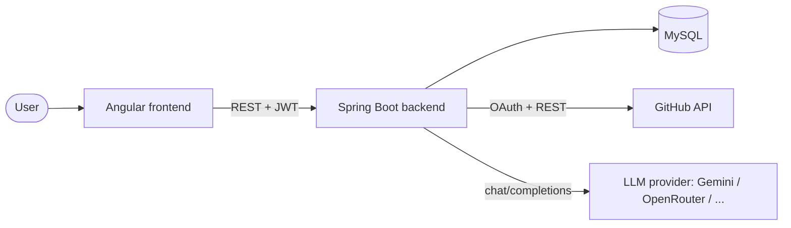
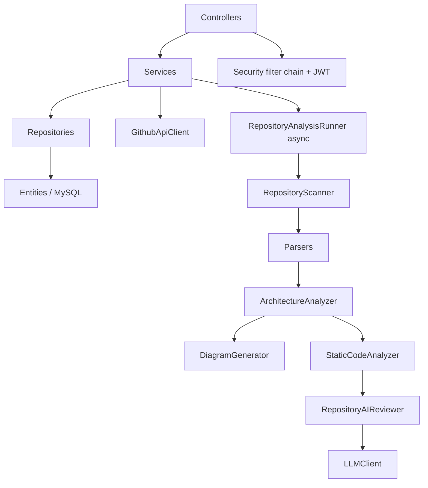
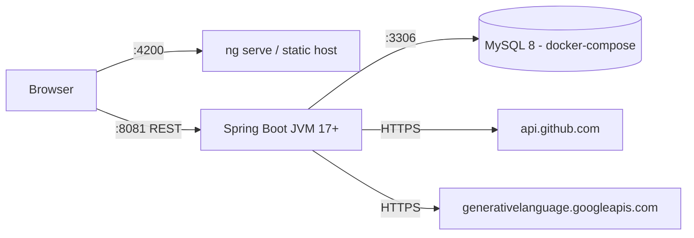
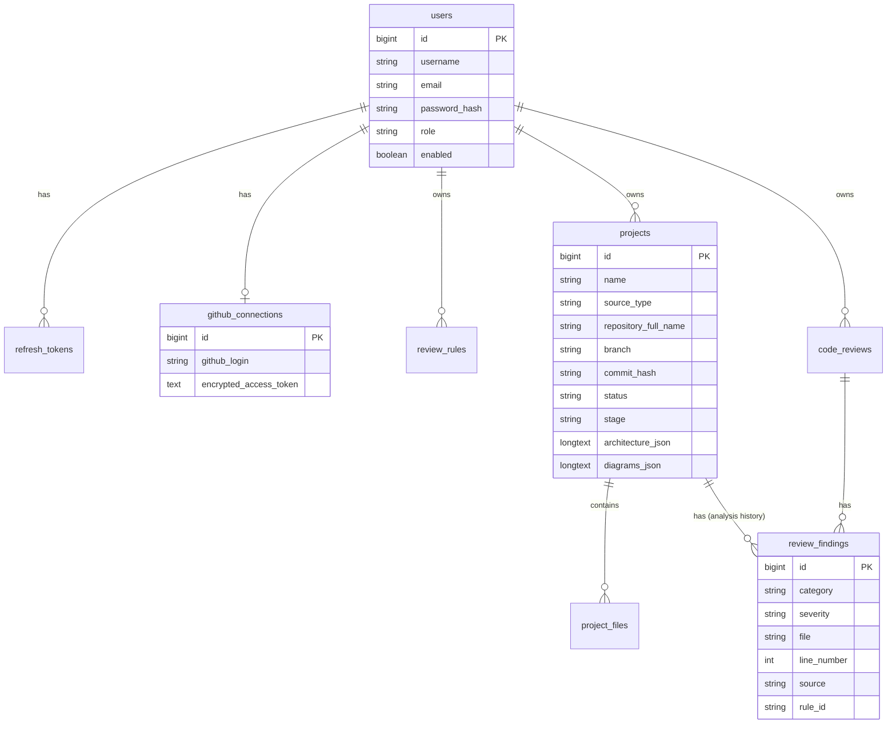
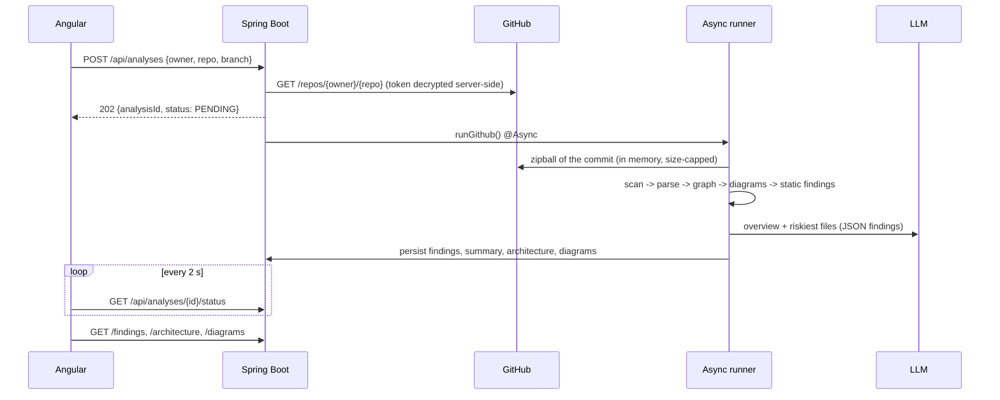

# Architecture

Angular SPA -> Spring Boot (single backend, no extra microservice) -> MySQL / GitHub API / LLM provider.

## System architecture

## Backend modules (package `com.aicodereview`)
| Module | Package | Role |
|---|---|---|
| Auth / User | `security`, `service.AuthService`, `controller.AuthController`, `AdminController` | register/login/refresh/logout, JWT filter, roles |
| Git | `github` | OAuth flow, encrypted token, repository listing, archive download |
| Analysis | `analysis` | scanner, parsers, technology detection, static analysis, async runner |
| Architecture | `analysis.ArchitectureAnalyzer`, `DiagramGenerator` | graph + Mermaid diagrams |
| AI | `ai`, `analysis.RepositoryAIReviewer` | LLM client + contextualised repository review |
| Rules | `rules` | custom review rules injected in the AI prompts |
| Report / history | `analysis.AnalysisService`, `dashboard` | status, findings, history, dashboard |
| Legacy (kept) | `service.Project*`, `ReviewService`, `analyzer` | ZIP import, single-file reviews, Bandit/Ruff/Gitleaks |

## Component diagram

## Deployment diagram

## Database ER diagram

Tables are created by Hibernate (`ddl-auto: update`). A *repository analysis* is a row of `projects` (`source_type` = `GITHUB` or `ZIP`) - it plays the role of the "CodeReview" history entity for whole-repository analysis.

## Repository analysis flow

## Static analysis vs AI analysis
| Static (deterministic, `source=STATIC`) | AI (`source=LLM`) |
|---|---|
| file filtering, technologies, imports, classes, methods | logic bugs |
| dependency graph, layering violations, cycles | security reasoning |
| cyclomatic complexity, long methods/classes | refactoring suggestions, explanations |
| secrets (masked), System.out, SQL concatenation, weak hashes | missing-test suggestions, custom rules |

The LLM never receives the whole repository: it gets (1) a compact structural overview, (2) the riskiest N files (`ANALYSIS_AI_MAX_FILES`, truncated), each with its direct relations and known static findings. Detected secrets are masked before sending; `.env`, keys and lock files are never read.
