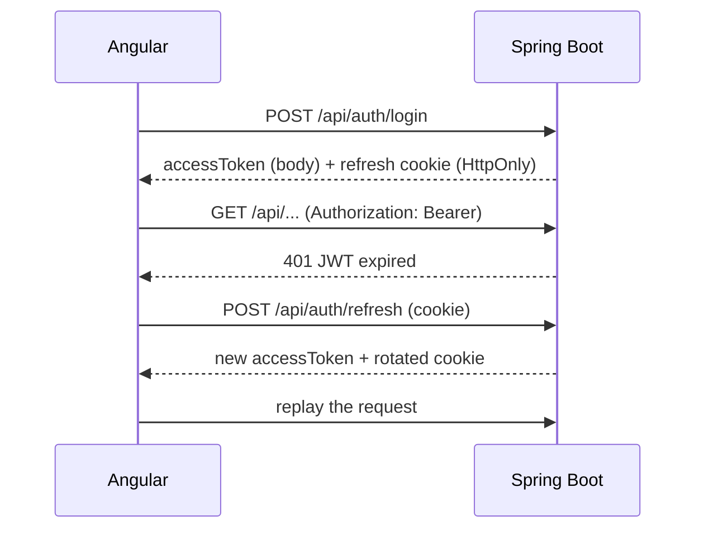

# Authentication

- `POST /api/auth/register|login` -> `{accessToken, tokenType, expiresIn, user}` + HttpOnly cookie `refresh_token` (path `/api/auth`, SameSite=Lax).
- Access token: HS256 JWT (claims `sub/uid`, `email`, `role`, `iat`, `exp`, `typ=access`), 15 min, kept **in memory** by Angular.
- `POST /api/auth/refresh`: rotates the refresh token (stored as SHA-256 hash). Re-using a revoked token revokes all the user's sessions.
- `POST /api/auth/logout`: revokes the refresh token and clears the cookie. `GET /api/auth/me`: current user.
- Passwords: BCrypt (cost 12). Self-registration always yields role `USER`; `ADMIN` is created through `ADMIN_EMAIL/ADMIN_PASSWORD` or by an admin (`PUT /api/admin/users/{id}`).
- Public endpoints are explicit in `SecurityConfig`; everything else requires a JWT; `/api/admin/**` requires `ROLE_ADMIN`.
- Errors: 401 `Invalid credentials` / `JWT expired` / `Invalid JWT`, 403 for missing permission, same JSON shape everywhere.
- Every project, analysis, review and rule is isolated per user (404 for foreign resources).

